# Detection types

The Detection Tester page tests one clause, or one imported Compound detection. The clause type decides which fields show. To test several clauses together, see [Import a manifest](import-manifest.md).

## What it does

The tool evaluates the clause on this computer and shows **Pass** or **Fail**, with one line of detail. Every test adds a row to the [history](history.md).

## When to use it

Use it to check a registry value, a registry key, a file or a script before you use it as a detection method.

## Requirements

None. See [Permissions](../reference/permissions.md) for the rights that a clause needs.

## Steps

### Choose the type

1. Select the list **Detection type**.
2. Select **RegistryKeyValue**, **RegistryKey**, **File**, **Script** or **Compound (import-only)**.

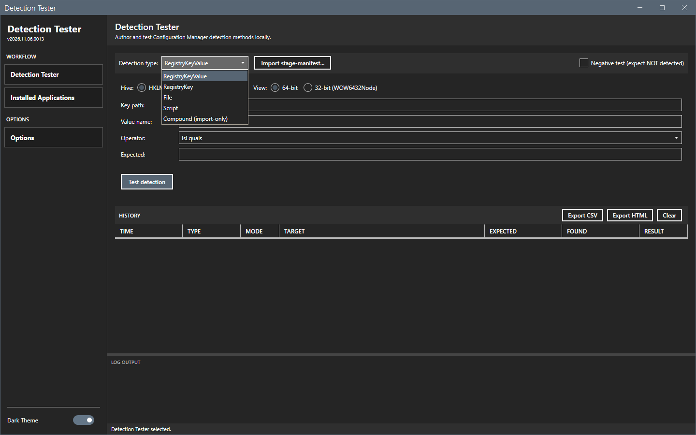

### Test a registry value

1. Select **HKLM** or **HKCU** for the hive.
2. Select **64-bit** or **32-bit (WOW6432Node)** for the view.
3. In **Key path**, enter the path below the hive, for example `SOFTWARE\Microsoft\Windows NT\CurrentVersion`.
4. In **Value name**, enter the name of the value.
5. In **Operator**, select the comparison.
6. In **Expected**, enter the value to compare.
7. Select **Test detection**.

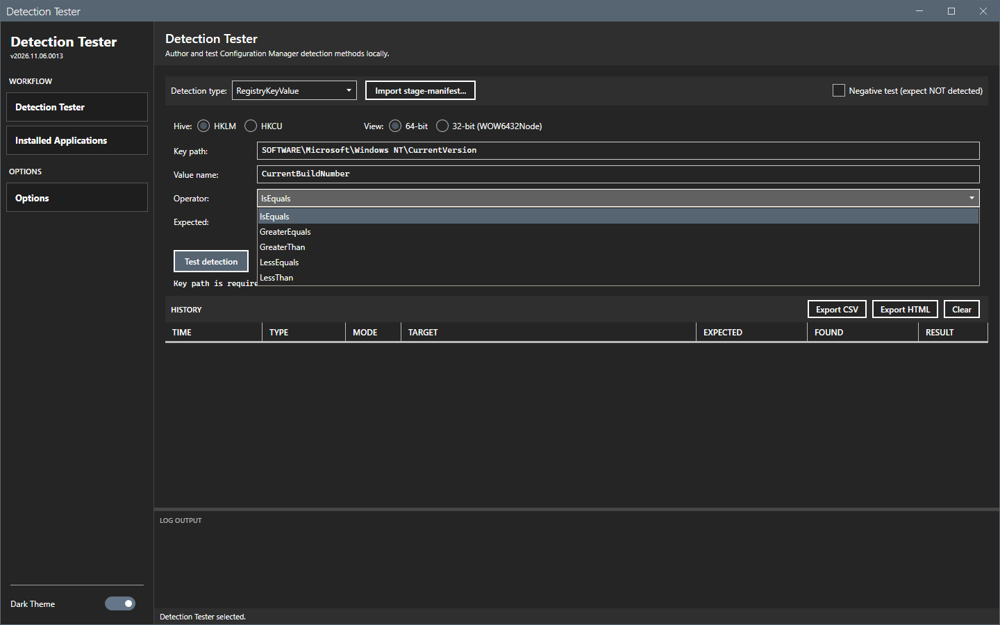

| Result | Detail line |
|---|---|
| **Pass** | `MATCH (IsEquals): '26200' vs '26200'` |
| **Fail**, value differs | `NO MATCH (IsEquals): '26200' vs '99999'` |
| **Fail**, value missing | `Value 'NoSuchValue' not found in key` |

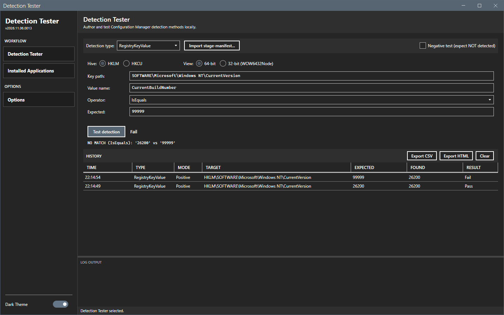

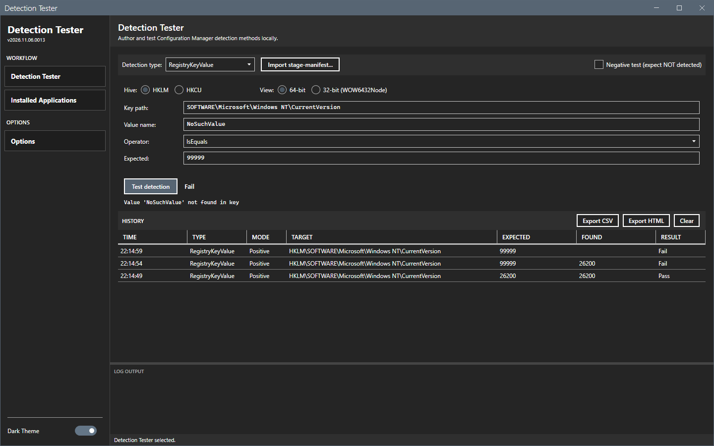

With HKCU and the 32-bit view the same key gives a different answer, because the clause reads another place.

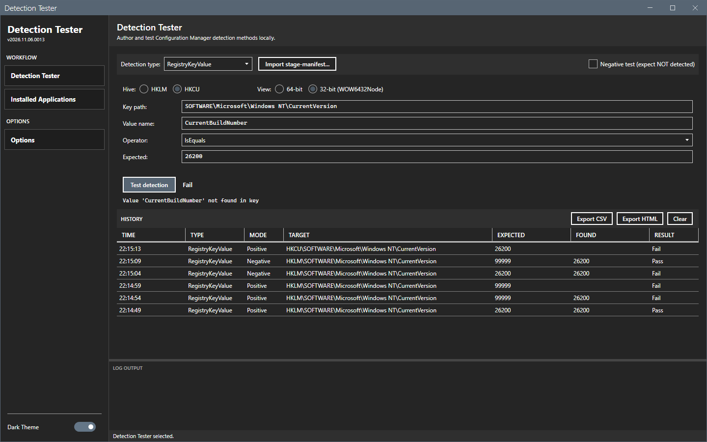

### Test a registry key

1. Select the type **RegistryKey**.
2. Select the hive and the view.
3. In **Key path**, enter the path below the hive.
4. Select **Test detection**. The clause passes when the key exists.

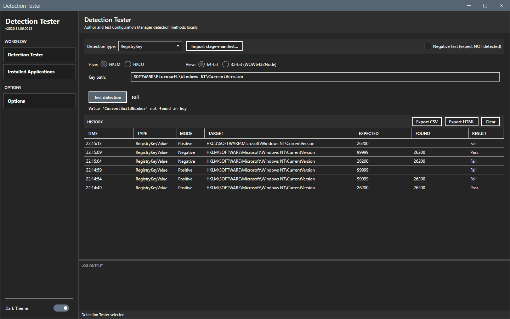

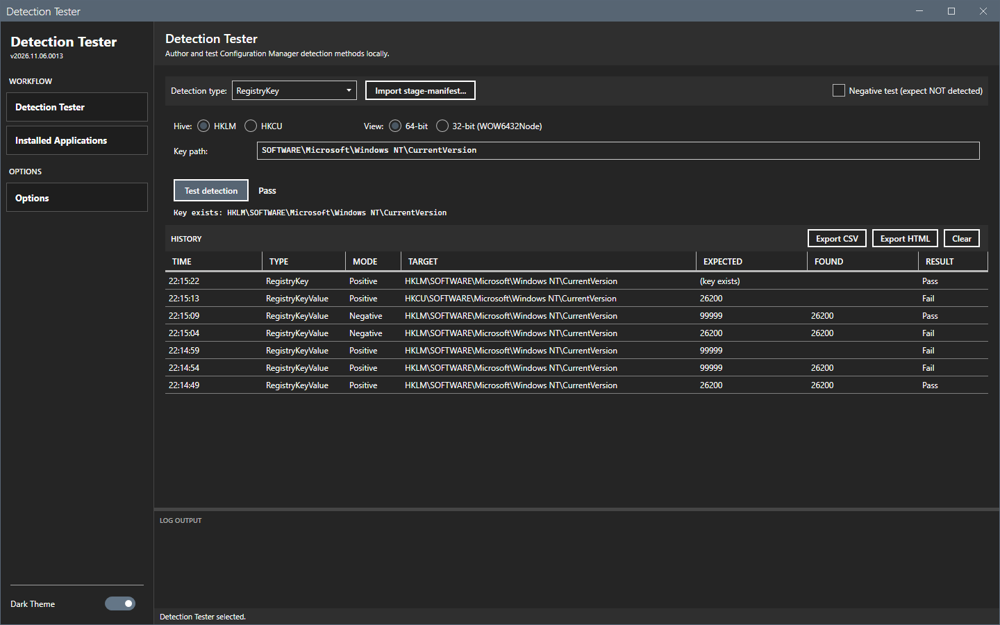

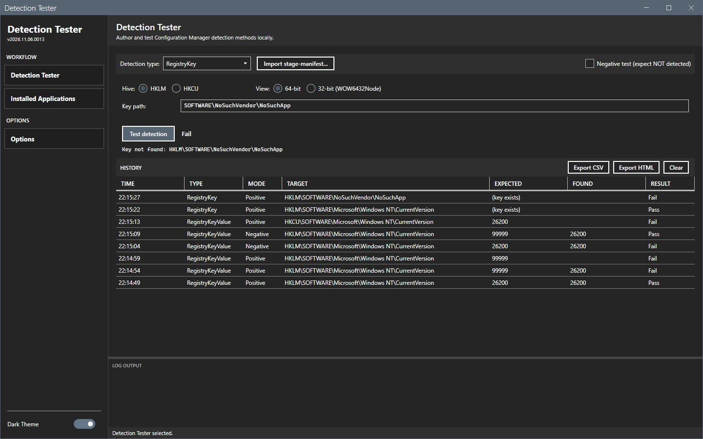

### Test a file

1. Select the type **File**.
2. Select **64-bit** or **32-bit (WOW64)**.
3. In the folder box, enter the folder, for example `C:\Windows\System32`.
4. In the file name box, enter the file name only, for example `notepad.exe`.
5. In the property list, select **Existence** or **Version**.
6. For **Version**, select an operator and enter the expected version, for example `10.0.0.0`.
7. Select **Test detection**.

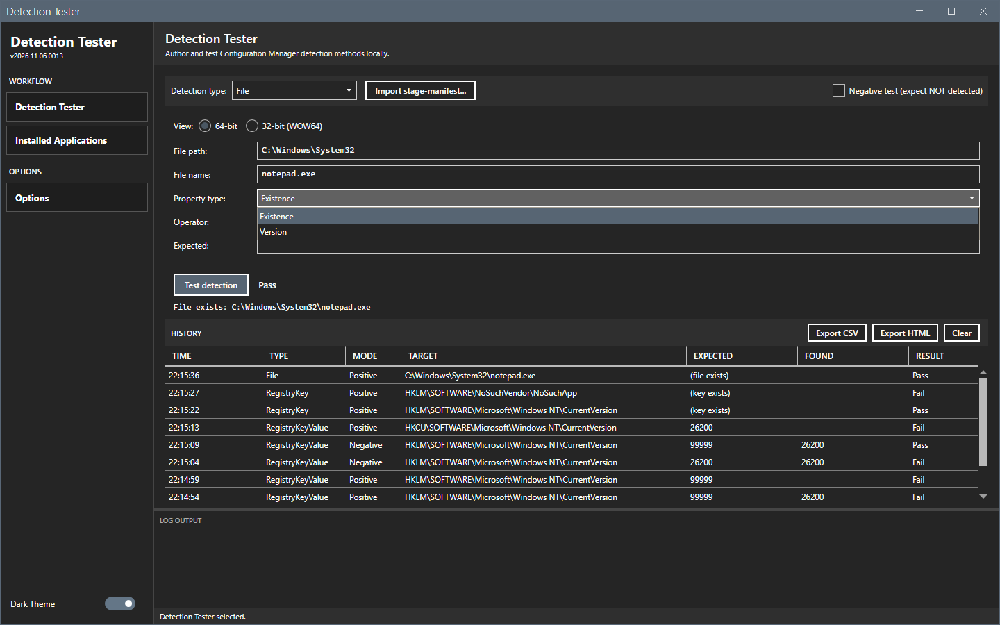

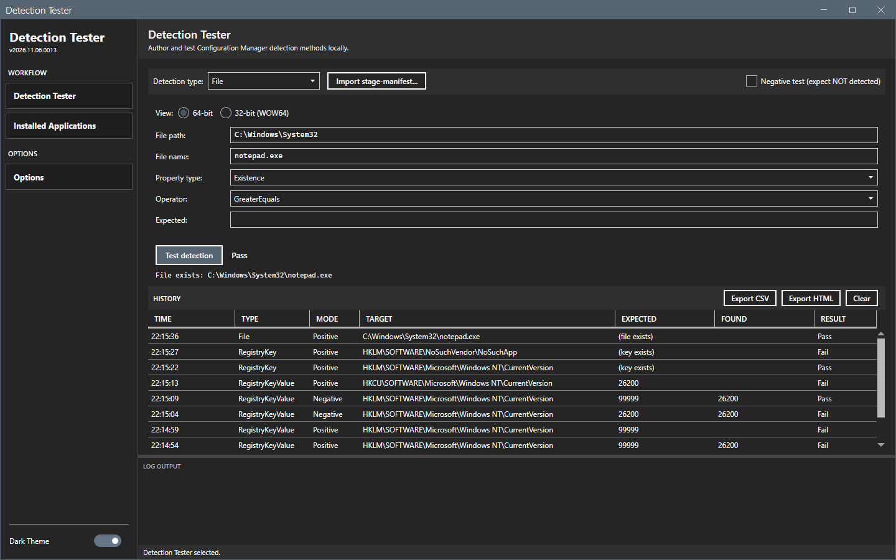

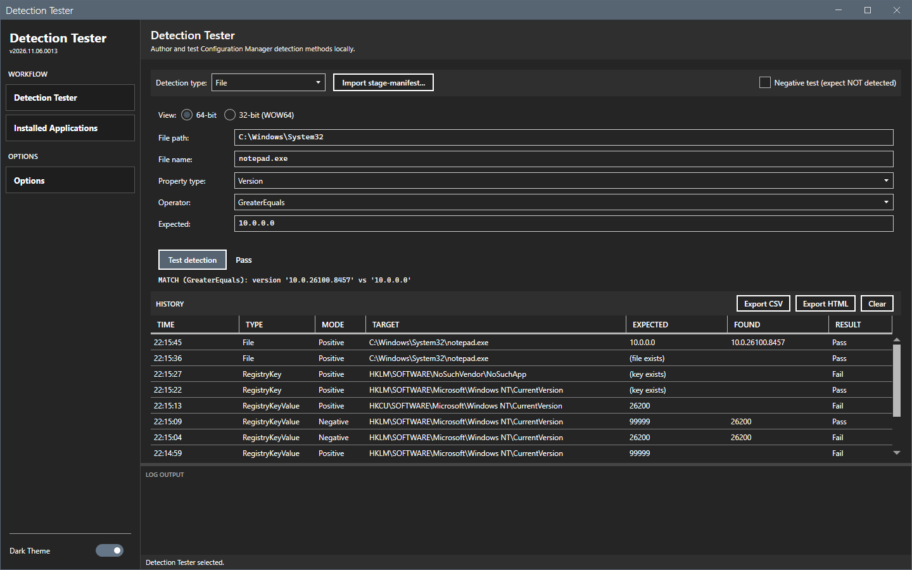

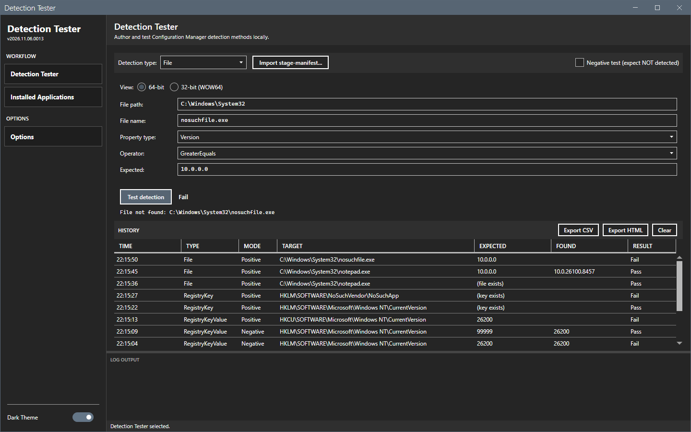

### Test a script

1. Select the type **Script**.
2. Enter the PowerShell script in the box. The clause passes when the script writes any text to the output.
3. Select **Test detection**. The test runs in the background with a time limit of 30 seconds, and the window stays usable.

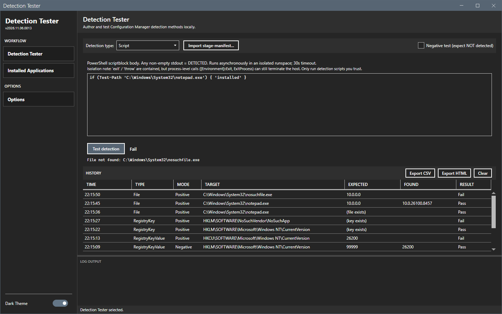

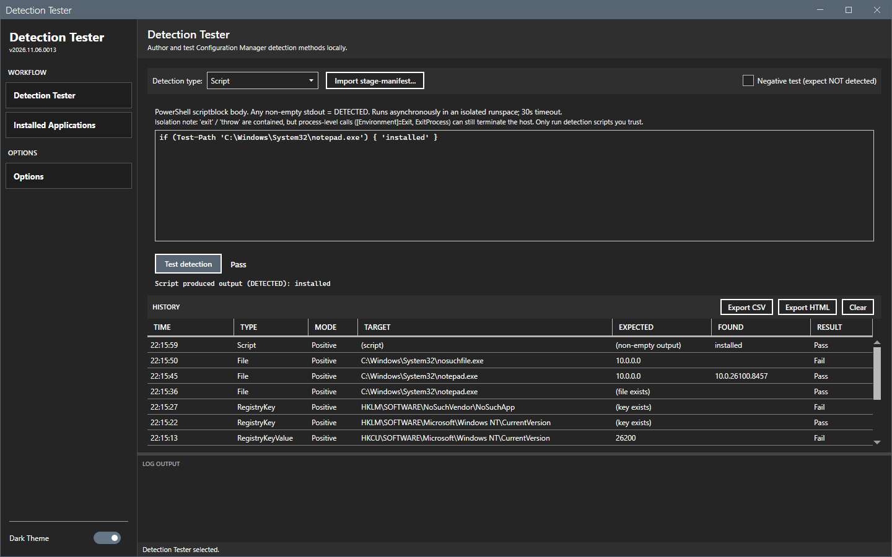

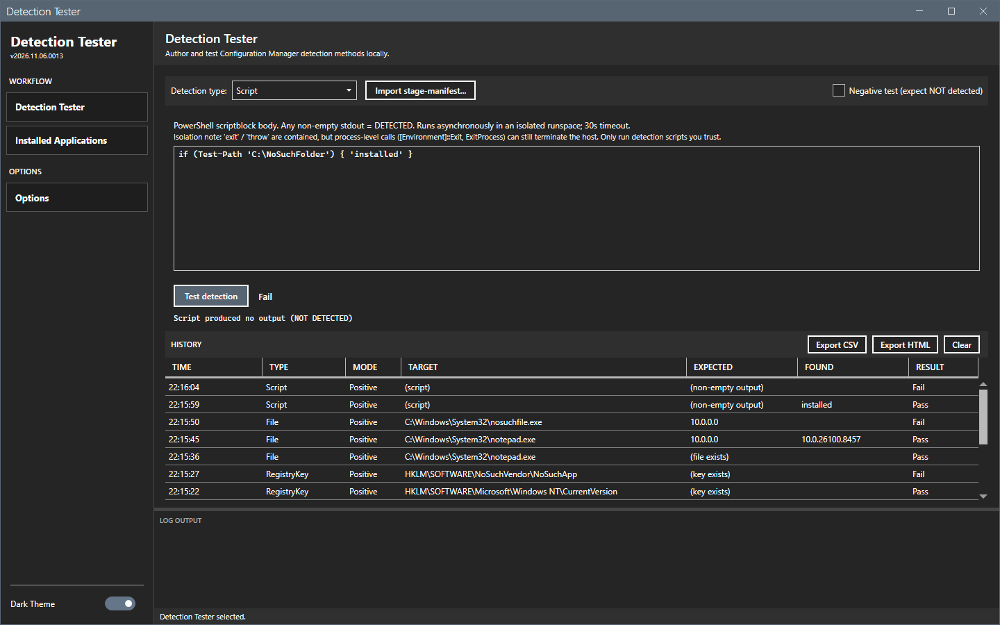

### Test with an empty field

A clause with a missing required field does not run. The result shows **Invalid clause** and names the field.

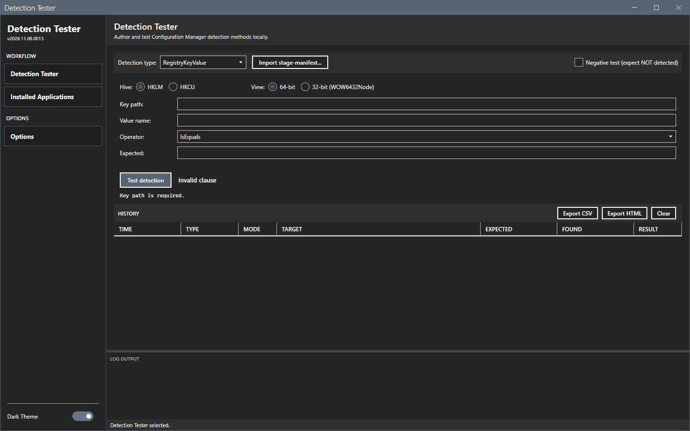

## Options and settings of this page

| Control | Effect |
|---|---|
| **Detection type** | Chooses the clause type. |
| **Import stage-manifest...** | Fills the clause from a file. See [Import a manifest](import-manifest.md). |
| **Negative test (expect NOT detected)** | Reverses Pass and Fail. See [Negative test](negative-test.md). |
| **Test detection** | Runs the clause. |

The operators of RegistryKeyValue are IsEquals, GreaterEquals, GreaterThan, LessEquals and LessThan. A comparison with a number or a version uses numbers or versions. IsEquals falls back to text equality when the value is not a number.

## Limits

- The result badge shows **Pass** or **Fail** as text. It has no color and no icon.
- The status bar does not change after a test.
- The tool tests this computer only.

## Troubleshooting

| Message | Cause | Fix |
|---|---|---|
| Invalid clause: Key path is required. | **Key path** is empty. | Enter the key path. |
| Value '<name>' not found in key | The value does not exist in that hive, view and key. | Check the hive, the view and the spelling. |

## Links

- [Create applications in Configuration Manager](https://learn.microsoft.com/intune/configmgr/apps/deploy-use/create-applications): Describes detection methods of an application.
- [Windows Registry Redirector](https://learn.microsoft.com/windows/win32/winprog64/registry-redirector): Explains the 32-bit view of the registry.
