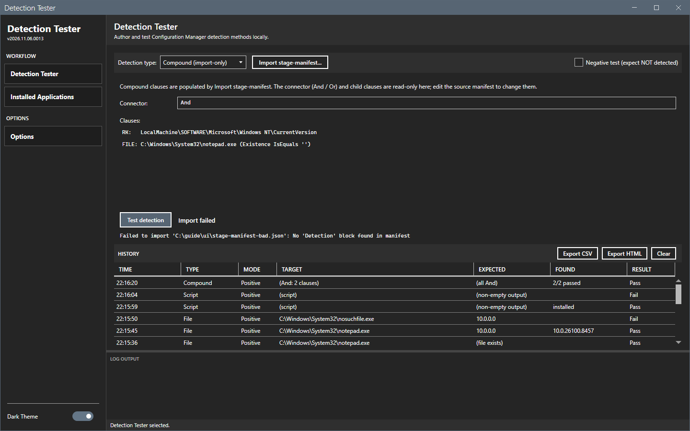
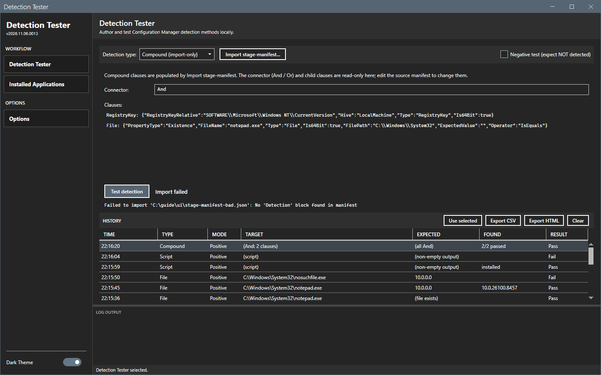

# History

The history grid lists every test of the session.

## What it does

Each test that gives a result adds one row at the top: the time, the type, the mode, the target, the expected value, the found value and the result. A script test that ends with an error shows **Error** on the result panel and adds no row. **Use selected** puts a row back in the form. **Export CSV** and **Export HTML** save the rows. **Clear** removes them.

## When to use it

Use it to repeat a test, to compare tests, or to keep a record of a session.

## Requirements

At least one test.

## Steps

### Read the history

1. Run some tests.
2. Read the grid below the result. The columns are **Time**, **Type**, **Mode** (Positive or Negative), **Target**, **Expected**, **Found** and **Result**.

### Repeat a test

1. Select a row. The button **Use selected** shows.
2. Select **Use selected**. The page sets the type, the fields and the negative check box from the row.
3. Select **Test detection**.

### Export the history

1. Select **Export CSV** or **Export HTML**. The Save As dialog opens in the reports folder with the name `detection-history-<date>-<time>`.
2. Select **Save**.

### Clear the history

Select **Clear**. The grid is empty. Nothing asks for a confirmation.

## Options and settings of this page

| Button | Effect |
|---|---|
| **Use selected** | Fills the form from the selected row. |
| **Export CSV** | Saves the rows as a CSV file. |
| **Export HTML** | Saves the rows as a self-contained HTML page. |
| **Clear** | Removes every row. |

## Limits

- The history lives in memory. It is lost when you close the tool.
- A script test that ends with an error adds no row, and the exports omit it.
- **Export CSV**, **Export HTML** and **Clear** work on all rows. They have no selection.

## Troubleshooting

| Message or symptom | Cause | Fix |
|---|---|---|
| **Export CSV** does nothing. | The history is empty. | Run a test first. |
| **Use selected** is missing. | No row is selected. | Select a row. |

## Links

None.
