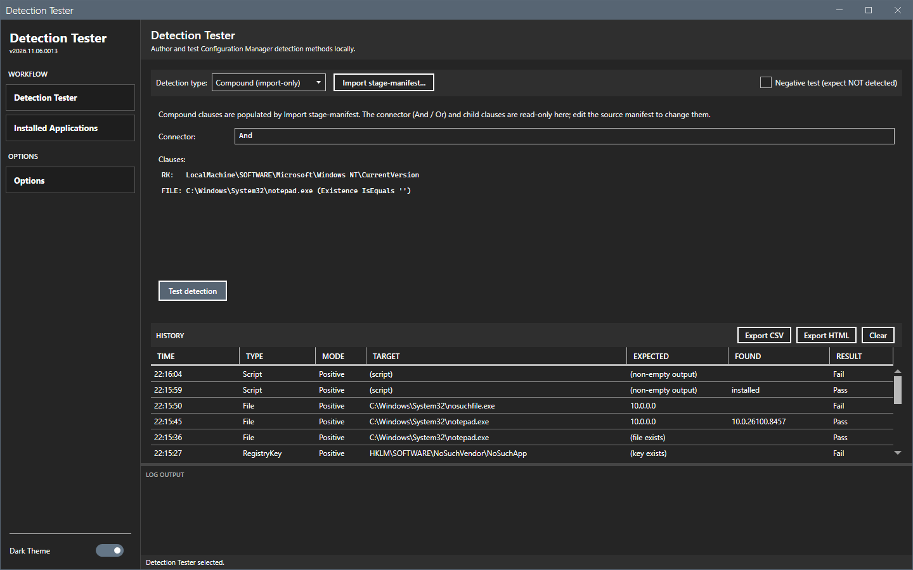
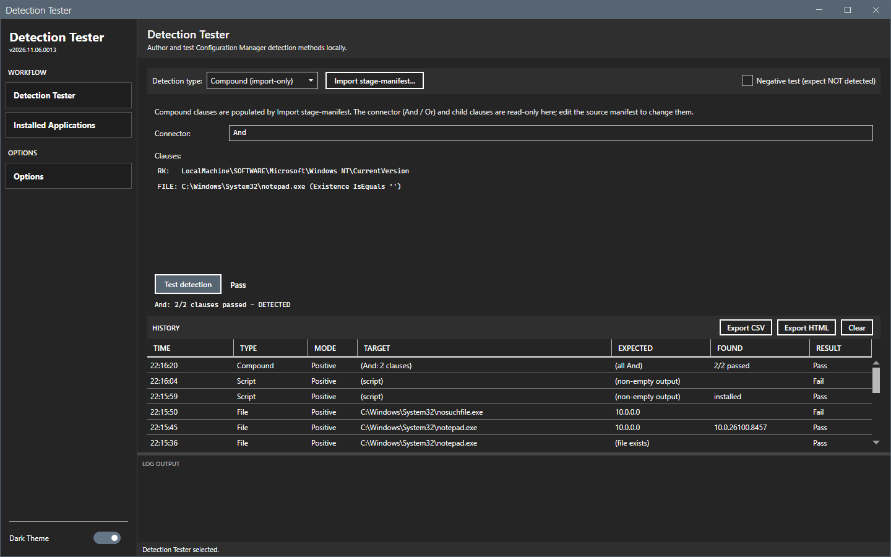
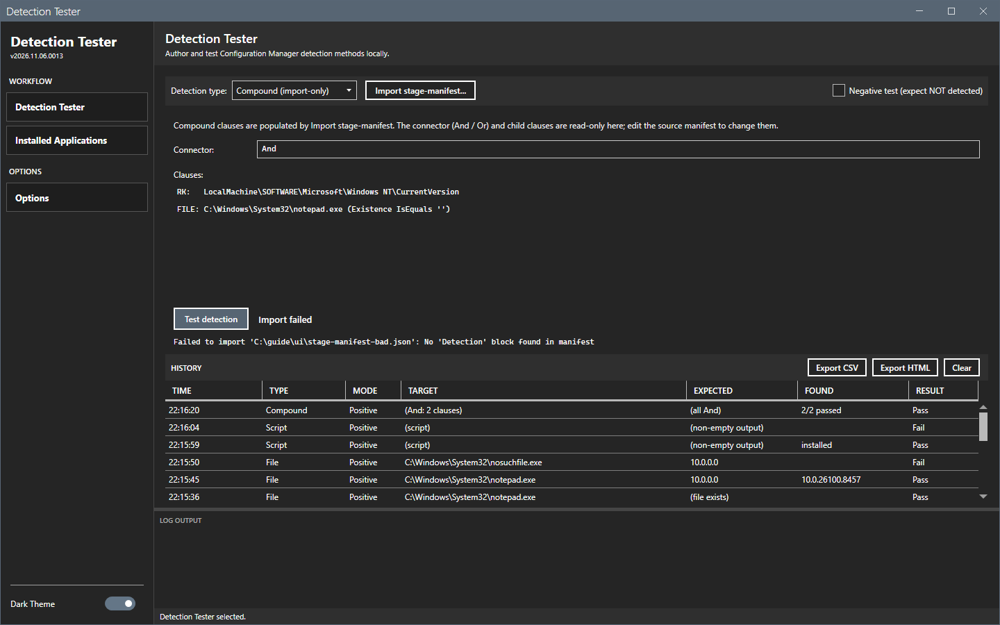

# Import a manifest

**Import stage-manifest...** fills the clause from the `Detection` block of a `stage-manifest.json` file.

## What it does

The tool reads the file, picks the type of the detection and fills the fields. A manifest with a connector and clauses becomes a Compound detection. The tool does not run the test until you select **Test detection**.

## When to use it

Use it to test the detection of a package that Application Packager staged.

## Requirements

A JSON file with a `Detection` block.

## Steps

### Import a manifest

1. Select **Import stage-manifest...**. The Open dialog is titled **Import stage-manifest.json**.
2. Select the file and select **Open**.
3. Read the fields. For a single clause, they show the clause. For a Compound detection, the type is **Compound (import-only)**, the **Connector** shows `And` or `Or`, and the list **Clauses** shows one line for each clause.

4. Select **Test detection**. The result shows **Pass** when the clauses satisfy the connector. The detail line reads, for example, `And: 2/2 clauses passed - DETECTED`.

A line of the Clauses list starts with `RK:` for a registry key, `RKV:` for a registry value, `FILE:` for a file or `SCRIPT:` for a script.

### Import a file with no Detection block

A file with no `Detection` block does not change the fields. The result shows **Import failed** and the reason.

## Options and settings of this page

The Compound clauses cannot be edited in the window. Edit the source manifest and import it again. After **Use selected** on a Compound history row, the clauses come back from the history.

## Limits

- The import reads only the `Detection` block.
- A Compound detection is test-only. The tool cannot author one.

## Troubleshooting

| Message | Cause | Fix |
|---|---|---|
| Failed to import: No 'Detection' block found in manifest | The file has no `Detection` block. | Import the `stage-manifest.json` of a staged build. |
| Failed to import: Failed to parse manifest JSON | The file is not valid JSON. | Fix the file. |
| Failed to import: Manifest file not found | The path does not exist. | Select an existing file. |

## Links

- [Create applications in Configuration Manager](https://learn.microsoft.com/intune/configmgr/apps/deploy-use/create-applications): Describes detection methods of an application.
