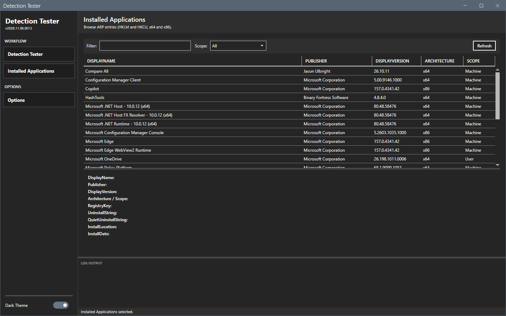
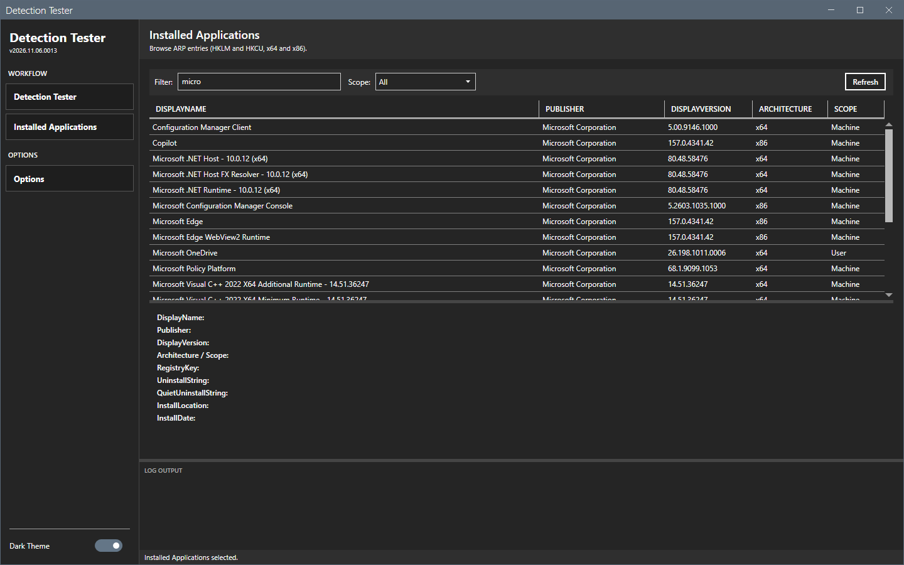
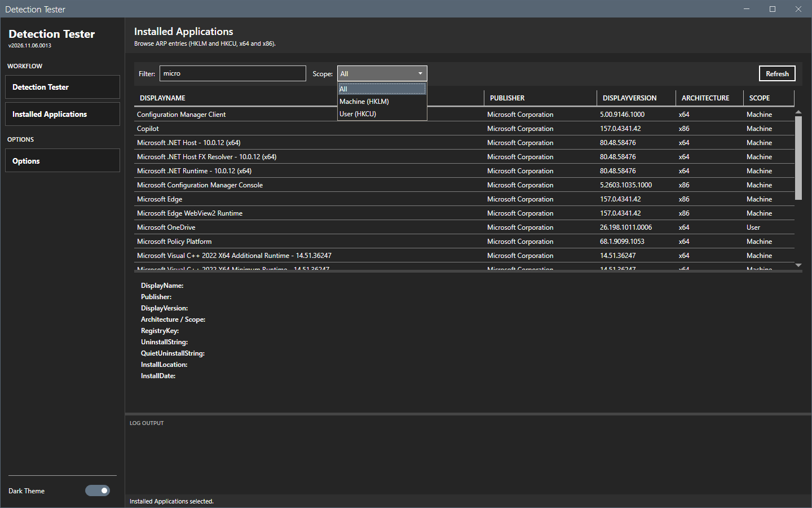
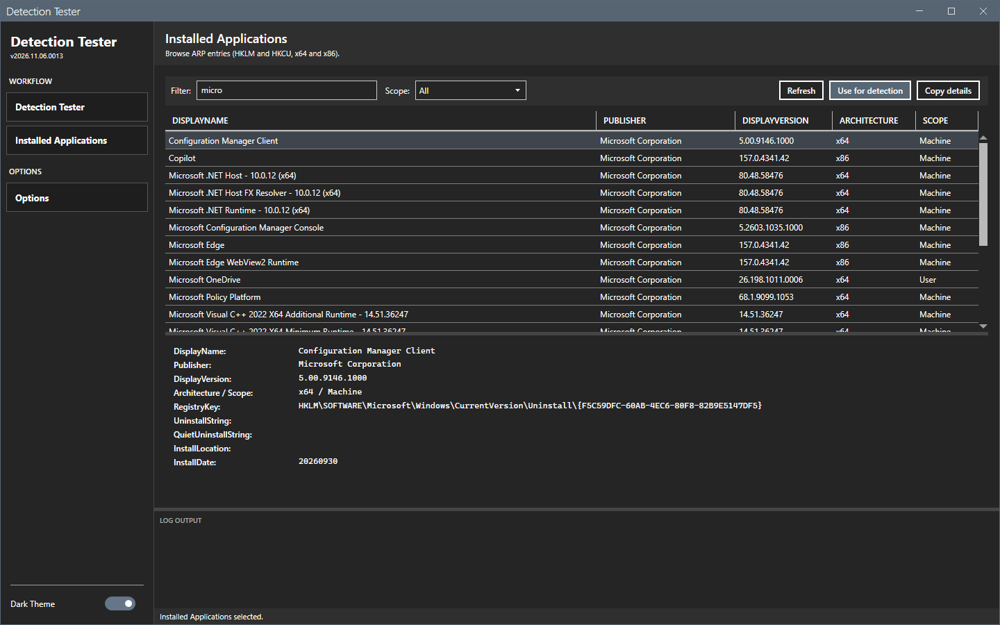
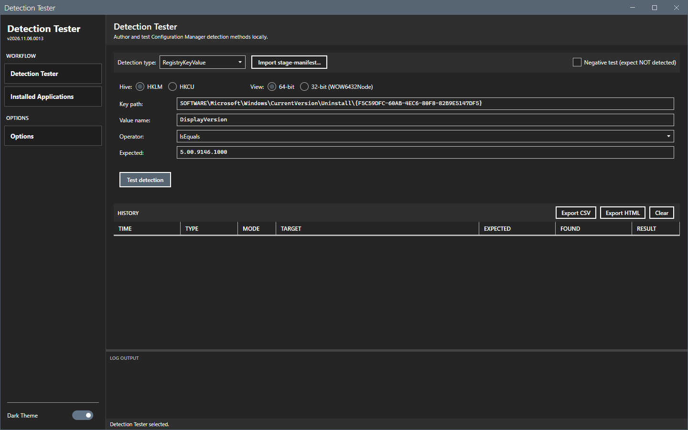

# Installed Applications

The Installed Applications page lists the uninstall entries of this computer and sends one of them to the Detection Tester.

## What it does

The page reads the ARP registry keys: HKLM 64-bit, HKLM 32-bit (WOW6432Node) and HKCU. The grid shows the display name, the publisher, the display version, the architecture and the scope. The panel under the grid shows the details of the selected entry.

## When to use it

Use it to find the registry key of an application and to build a registry value clause from it.

## Requirements

None.

## Steps

### Browse the entries

1. Select **Installed Applications** in the sidebar. The grid fills.
2. Read the columns: **DisplayName**, **Publisher**, **DisplayVersion**, **Architecture** and **Scope**.

### Filter

1. In **Filter**, enter part of a name, a publisher or a version. The grid shows the matches.
2. In **Scope**, select **All**, **Machine (HKLM)** or **User (HKCU)**.

Select **Refresh** to read the registry again.

### Read the details

Select a row. The panel shows **DisplayName**, **Publisher**, **DisplayVersion**, **Architecture / Scope**, **RegistryKey**, **UninstallString**, **QuietUninstallString**, **InstallLocation** and **InstallDate**.

Select **Copy details** to copy these lines to the clipboard.

An entry can have no `DisplayVersion`. The clause that **Use for detection** fills then has an empty expected value and fails in a positive test. Change **Value name** to another value that the key has, for example `DisplayName`, and enter its value in **Expected**.

### Use an entry for a detection

1. Select a row.
2. Select **Use for detection**. The Detection Tester page opens with the type RegistryKeyValue, the key of the entry, the value name `DisplayVersion`, the version of the entry as the expected value, the operator IsEquals, and the hive and the view of the entry.
3. Select **Test detection**.

## Options and settings of this page

| Control | Effect |
|---|---|
| **Filter** | Narrows the grid. |
| **Scope** | **All**, **Machine (HKLM)** or **User (HKCU)**. |
| **Refresh** | Reads the registry again. |
| **Use for detection** | Fills a registry value clause. |
| **Copy details** | Copies the details of the entry. |

## Limits

- The tool lists only entries that have a display name.
- The InstallDate is the text of the entry, for example `20260930`.

## Troubleshooting

| Message or symptom | Cause | Fix |
|---|---|---|
| An application is missing. | It has no ARP entry, or it installs per user for another account. | Look in the **User (HKCU)** scope of the right account. |
| **Use for detection** does nothing. | No row is selected. | Select a row. |

## Links

- [Uninstall registry key](https://learn.microsoft.com/windows/win32/msi/uninstall-registry-key): Describes the values of an uninstall entry.
