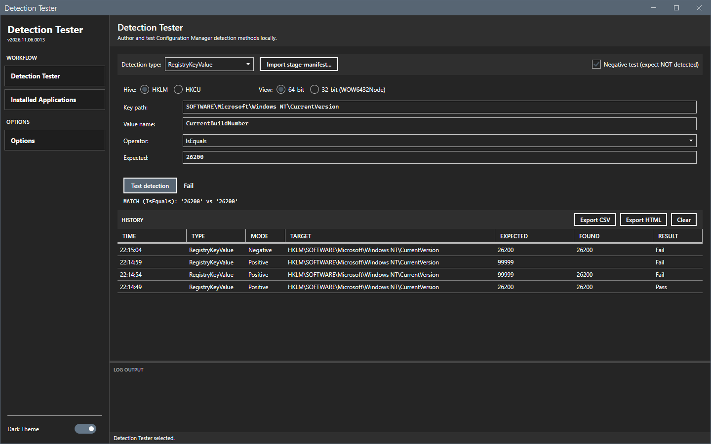
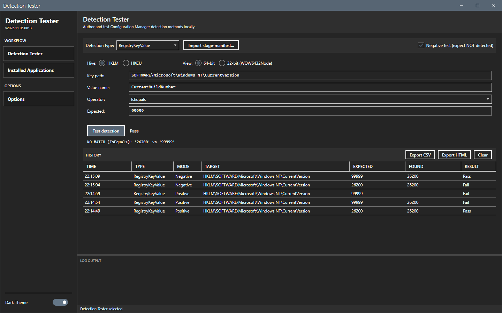

# Negative test

A negative test passes when the clause is not detected.

## What it does

With **Negative test (expect NOT detected)** selected, the tool reverses the result of the clause. A clause that is detected gives **Fail**. A clause that is not detected gives **Pass**.

## When to use it

Use it to check that an uninstall removed the registry entry or the file that the detection method looks for.

## Requirements

None.

## Steps

1. Fill a clause. See [Detection types](detection-types.md).
2. Select **Negative test (expect NOT detected)**.
3. Select **Test detection**.

A clause that is detected fails the negative test. The detail line still shows the real comparison.

A clause that is not detected passes the negative test. Read the detail line before you take a pass as proof that the application is gone. When the account cannot read a registry key, the clause can be not detected although the key exists.

The history grid shows **Negative** in the **Mode** column for these rows. **Use selected** restores the check box. See [History](history.md).

## Options and settings of this page

| Control | Effect |
|---|---|
| **Negative test (expect NOT detected)** | Reverses Pass and Fail. It applies to every type. The selection stays until you clear it. |

## Limits

- The detail line does not say that the result is reversed.

## Troubleshooting

| Message or symptom | Cause | Fix |
|---|---|---|
| A test shows **Fail** although the detail line says MATCH. | **Negative test** is selected. | Clear the check box. |

## Links

- [Create applications in Configuration Manager](https://learn.microsoft.com/intune/configmgr/apps/deploy-use/create-applications): Describes detection methods of an application.
