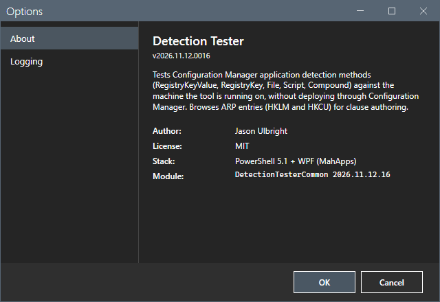
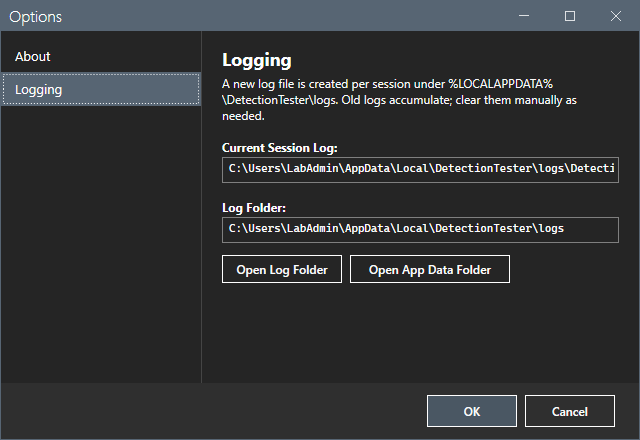
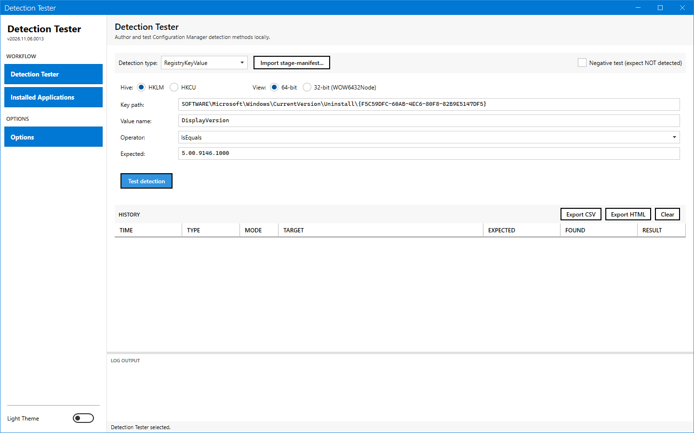
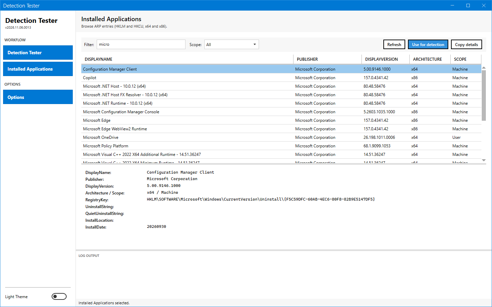
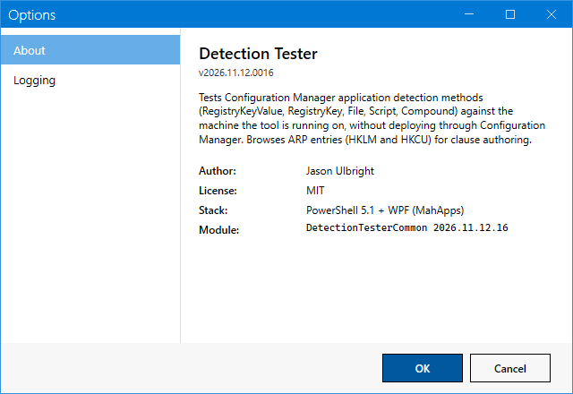

# Options dialog

The Options dialog shows the version of the tool and where it writes its log.

## What it does

The dialog has a list with two sections, **About** and **Logging**. The dialog has no setting that you can change.

## When to use it

Use it to read the version or to find the log of the session.

## Requirements

None.

## Steps

1. Select **Options** in the sidebar.
2. Select **About** to read the version, the module version, the author, the license and the stack.

3. Select **Logging** to read the path of the log of this session and the log folder. **Open Log Folder** opens the folder in Explorer. **Open App Data Folder** opens %LOCALAPPDATA%\DetectionTester.

4. Select **OK** or **Cancel**, or press Esc, to close the dialog. The three ways have the same effect.

The theme toggle is at the bottom of the sidebar. The images below show the light theme.

## Options and settings of this page

None. The log folder is `%LOCALAPPDATA%\DetectionTester\logs`. The tool creates one log for each session and never deletes one.

## Limits

- The box of the session log path is one line wide and cuts a long path. Select the box and press End to read the end of the path.
- The dialog has no setting.

## Troubleshooting

None.

## Links

None.
