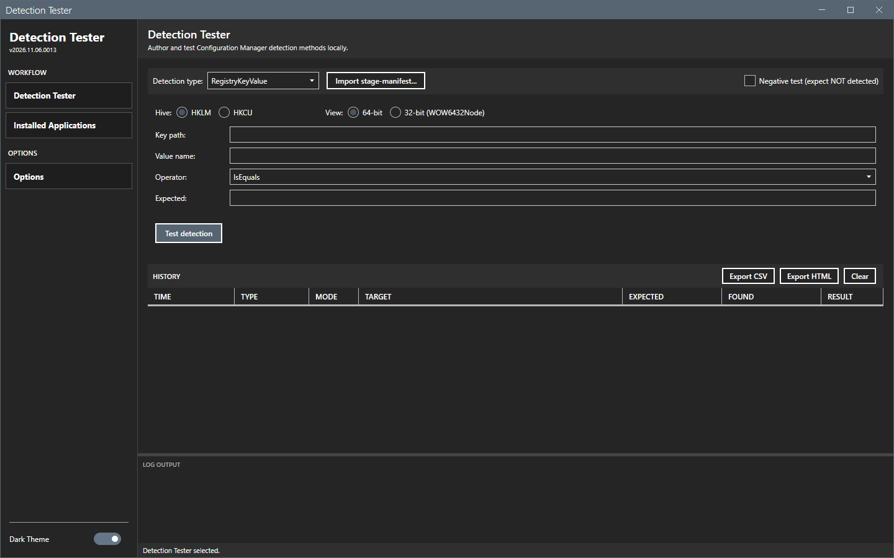
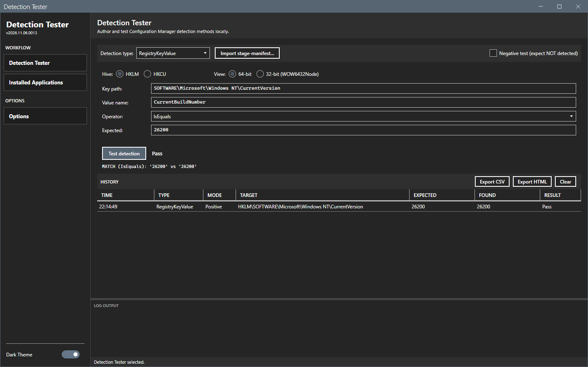
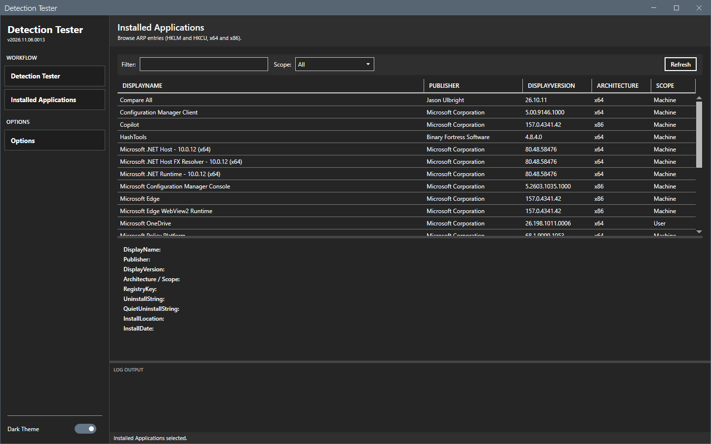

# Getting started

This page shows how to install Detection Tester, start it and run the first test.

## What it does

Detection Tester evaluates a detection clause on this computer: a registry value, a registry key, a file or a PowerShell script. It shows Pass or Fail with the reason, and keeps a history of the tests. It also lists the installed applications to help you write a clause.

## When to use it

Use it before you put a detection method in a Configuration Manager application, to see that the clause finds the application.

## Requirements

- Windows 10, Windows 11 or Windows Server 2016 or later.
- Windows PowerShell 5.1.
- .NET Framework 4.7.2 or later.
- A window of at least 900 by 600 pixels. The window opens at 1100 by 750.
- No administrator rights, no Configuration Manager console and no site connection. The Script clause runs PowerShell on this computer.

## Steps

### Install

1. Download the release zip from the Releases page of the project.
2. Extract it to a folder.
3. Start the tool from a PowerShell prompt in the folder:

   ```powershell
   powershell -ExecutionPolicy Bypass -File start-detectiontester.ps1
   ```

   You can also right-click `start-detectiontester.ps1` and select **Run with PowerShell**.



The sidebar shows the version under the title, two pages (**Detection Tester** and **Installed Applications**) and **Options**. The window opens on the **Detection Tester** page with the type **RegistryKeyValue**.

### Run the first test

1. In **Key path**, enter `SOFTWARE\Microsoft\Windows NT\CurrentVersion`.
2. In **Value name**, enter `CurrentBuildNumber`.
3. In **Expected**, enter the build number of this computer, for example `26200`.
4. Select **Test detection**.



The result shows **Pass** and the line `MATCH (IsEquals): '26200' vs '26200'`. The history grid gets one row.

### Start the tool again

The tool keeps the theme and the page that was open. It does not keep the history.



## Options and settings of this page

None. See [Options dialog](core/options.md) and [Settings](reference/settings.md).

## Limits

- The tool tests only the computer that runs it.

## Troubleshooting

See [Troubleshooting](troubleshooting.md).

## Links

- [Create applications in Configuration Manager](https://learn.microsoft.com/intune/configmgr/apps/deploy-use/create-applications): Describes applications, deployment types and detection methods.
